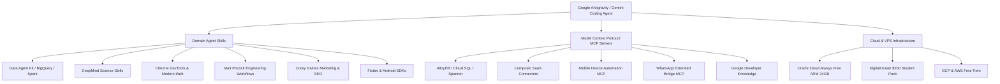

# Awesome Antigravity, Agent Skills & MCP Developer Stack 🚀

[](https://github.com/sindresorhus/awesome)
[](https://modelcontextprotocol.io/)
[](https://ai.google.dev/)
[](LICENSE)
[](CONTRIBUTING.md)

> A curated, battle-tested directory of **Google Antigravity (AGY)** agent skills, official **Model Context Protocol (MCP)** servers, **Free Cloud VPS hosting** opportunities (Oracle, GCP, AWS), and the **GitHub Student Developer Pack** value guide.

---

## 📑 Table of Contents

- [🌟 Overview](#-overview)
- [🧠 Antigravity & Agent Skills Catalog](#-antigravity--agent-skills-catalog)
  - [1. Google Cloud Data & Analytics (Data Agent Kit)](#1-google-cloud-data--analytics-data-agent-kit)
  - [2. Google DeepMind Science & Bio-Informatics](#2-google-deepmind-science--bio-informatics)
  - [3. Modern Web & Chrome DevTools Engineering](#3-modern-web--chrome-devtools-engineering)
  - [4. Software Architecture & Engineering Craft (Matt Pocock Skills)](#4-software-architecture--engineering-craft-matt-pocock-skills)
  - [5. Growth, SEO & Conversion Engineering (Marketing Skills)](#5-growth-seo--conversion-engineering-marketing-skills)
  - [6. Mobile & Cross-Platform (Flutter & Android)](#6-mobile--cross-platform-flutter--android)
  - [7. Fullstack Firebase Suite](#7-fullstack-firebase-suite)
  - [8. Gemini Multimodal & Antigravity SDK](#8-gemini-multimodal--antigravity-sdk)
- [🔌 Model Context Protocol (MCP) Servers Directory](#-model-context-protocol-mcp-servers-directory)
  - [Installed & Configured MCP Servers](#installed--configured-mcp-servers)
  - [Ready-to-Use `mcp_config.json` Template](#ready-to-use-mcp_configjson-template)
- [☁️ Free Cloud VPS & Hosting Directory](#️-free-cloud-vps--hosting-directory)
  - [Oracle Cloud Always Free (The Gold Standard)](#oracle-cloud-always-free-the-gold-standard)
  - [Google Cloud Platform (GCP) Free Tier](#google-cloud-platform-gcp-free-tier)
  - [Amazon Web Services (AWS) Free Tier](#amazon-web-services-aws-free-tier)
  - [Modern PaaS & Container Free Tiers](#modern-paas--container-free-tiers)
- [🎓 GitHub Student Developer Pack: The Complete Playbook](#-github-student-developer-pack-the-complete-playbook)
  - [Top Perks & Free Credits](#top-perks--free-credits)
  - [How to Claim & Get Approved](#how-to-claim--get-approved)
- [🛠️ Quick Installation & Setup Guide](#️-quick-installation--setup-guide)
- [🤝 Contributing & Community](#-contributing--community)
- [📜 License](#-license)

---

## 🌟 Overview

As AI-assisted pair programming and autonomous coding agents evolve, having the right **Agent Skills** (domain expertise modules via standard `SKILL.md` protocols) and **MCP Servers** (Model Context Protocol data and execution bridges) creates a 10x developer leverage.

This repository catalogs the exact agent setup, plugins, tools, cloud infrastructure hacks, and student benefits used daily for high-velocity software engineering, cloud architecture, mobile development, and data science.



---

## 🧠 Antigravity & Agent Skills Catalog

Agent skills follow the open [Agent Skills Specification](https://agentskills.io/). They equip agents with structured guidelines, domain heuristics, code generators, and execution guardrails.

### 1. Google Cloud Data & Analytics (Data Agent Kit)
*Specialized suite for database administrators, data engineers, and ML practitioners.*
* **Source:** [GoogleCloudPlatform/data-agent-kit](https://github.com/GoogleCloudPlatform/data-agent-kit)

| Skill Name | Description | Key Capabilities |
| :--- | :--- | :--- |
| [`bigquery-sql`](skills-catalog.md#data-agent-kit) | High-performance BigQuery SQL optimization | Partitioning, clustering, anti-pattern detection, cost reduction |
| [`bigquery-ai-ml`](skills-catalog.md#data-agent-kit) | In-database Machine Learning & GenAI | Time-series forecasting, k-means clustering, LLM inference in SQL |
| [`bigquery-bigframes`](skills-catalog.md#data-agent-kit) | BigQuery DataFrames (pandas/scikit-learn API) | Scalable Python analytics directly executed over BigQuery engine |
| [`dataform-bigquery`](skills-catalog.md#data-agent-kit) | Dataform ELT pipeline orchestration | SQLX authoring, dependency trees, table declarations |
| [`dbt-bigquery`](skills-catalog.md#data-agent-kit) | dbt models & pipeline engineering | Jinja templating, schema tests, incremental materialization |
| [`gcp-spark`](skills-catalog.md#data-agent-kit) | PySpark on Dataproc Serverless & Clusters | BigLake Iceberg catalogs, Spanner connectors, batch execution |
| [`gcp-dataflow`](skills-catalog.md#data-agent-kit) | Apache Beam streaming/batch pipelines | Flex templates, Cloud Build packaging, backpressure tuning |
| [`accidental-data-loss-prevention`](skills-catalog.md#data-agent-kit) | Irreversible operation blocker | Guardrails preventing accidental `DROP`, `TRUNCATE`, or bulk deletes |
| [`building-data-apps`](skills-catalog.md#data-agent-kit) | Rapid full-stack data dashboards | React + Vite or Streamlit UIs with Gemini Data Analytics chat |
| [`discovering-gcp-data-assets`](skills-catalog.md#data-agent-kit) | Dataplex & BigLake discovery engine | Catalog search, policy tags, dataset schema inspection |
| [`federate-lakehouse-catalog`](skills-catalog.md#data-agent-kit) | Remote Iceberg REST catalog federation | Querying Databricks Unity Catalog and AWS Glue from BigQuery |
| [`gcp-composer-troubleshooting`](skills-catalog.md#data-agent-kit) | Cloud Composer (Airflow) RCA & fixing | Automated DAG failure diagnosis, task logs inspection |
| [`gcs-security-assessment`](skills-catalog.md#data-agent-kit) | Cloud Storage security posture auditor | SAIF compliance, IAM auditing, bucket public access inspection |

---

### 2. Google DeepMind Science & Bio-Informatics
*Curated collection of biological, structural, genomic, and chemical research skills created by Google DeepMind.*
* **Repository:** [google-deepmind/science-skills](https://github.com/google-deepmind/science-skills)
* **Skills Registry:** [skills.sh/google-deepmind/science-skills](https://skills.sh/google-deepmind/science-skills)

| Skill Name | Biological / Scientific Focus | Source Database / API |
| :--- | :--- | :--- |
| [`alphafold_database_fetch_and_analyze`](skills-catalog.md#deepmind-science) | Structural confidence (pLDDT), domain boundaries | AlphaFold Protein Structure Database |
| [`alphagenome_single_variant_analysis`](skills-catalog.md#deepmind-science) | Non-coding variant impacts on expression & splicing | AlphaGenome Deep Learning Engine |
| [`chembl_database`](skills-catalog.md#deepmind-science) | Bioactive molecules, drug targets, $IC_{50}$ / $K_i$ values | EMBL-EBI ChEMBL Database |
| [`pubchem_database`](skills-catalog.md#deepmind-science) | Chemical structure search, CID, SMILES, bioassays | NCBI PubChem |
| [`pubmed_database`](skills-catalog.md#deepmind-science) | Biomedical literature discovery & full-text extraction | NCBI PubMed / PMC BioC |
| [`clinical_trials_database`](skills-catalog.md#deepmind-science) | Human clinical trials, eligibility criteria, phases | ClinicalTrials.gov API v2 |
| [`clinvar_database`](skills-catalog.md#deepmind-science) | Genomic variant pathogenicity classifications | NCBI ClinVar |
| [`gnomad_database`](skills-catalog.md#deepmind-science) | Population allele frequencies, pLI & LOEUF scores | gnomAD (Broad Institute) |
| [`foldseek_structural_search`](skills-catalog.md#deepmind-science) | Fast 3D structural alignment for PDB / CIF files | Foldseek API |
| [`pymol`](skills-catalog.md#deepmind-science) | Molecular graphics rendering, binding sites, B-factors | PyMOL Open-Source Engine |
| [`predictingthepast`](skills-catalog.md#deepmind-science) | Ancient epigraphic text restoration and dating | DeepMind Aeneas & Ithaca Models |

---

### 3. Modern Web & Chrome DevTools Engineering
*Official Chrome DevTools and Google Chrome Web Platform skills for performance, accessibility, and modern CSS/JS.*
* **DevTools MCP:** [ChromeDevTools/chrome-devtools-mcp](https://github.com/ChromeDevTools/chrome-devtools-mcp)
* **Modern Web Guidance:** [GoogleChrome/modern-web-guidance](https://github.com/GoogleChrome/modern-web-guidance)

| Skill Name | Purpose | Highlights |
| :--- | :--- | :--- |
| [`chrome-devtools`](skills-catalog.md#modern-web) | Live browser automation & debugging | Puppeteer CDP integration, network request inspection, DOM evaluation |
| [`a11y-debugging`](skills-catalog.md#modern-web) | Accessibility compliance auditing | WCAG 2.2, ARIA landmark checks, keyboard focus traps, color contrast |
| [`debug-optimize-lcp`](skills-catalog.md#modern-web) | Core Web Vitals optimization | Largest Contentful Paint breakdown, render-blocking resource elimination |
| [`memory-leak-debugging`](skills-catalog.md#modern-web) | JavaScript memory leak diagnostics | Heap snapshots, retained objects analysis, MemLab automation |
| [`modern-web-guidance`](skills-catalog.md#modern-web) | Modern web standards enforcement | View Transitions, Scroll-driven animations, popover API, `:has()` CSS |
| [`chrome-extensions`](skills-catalog.md#modern-web) | Manifest V3 Extension development | Background service workers, content script sandboxing, Web Store publishing |

---

### 4. Software Architecture & Engineering Craft (Matt Pocock Skills)
*Engineering disciplines, rigorous design stress-testing, and automated developer workflows.*
* **Repository:** [mattpocock/skills](https://github.com/mattpocock/skills)
* **Author:** [Matt Pocock](https://www.aihero.dev/)

| Skill Name | Description | When to Trigger |
| :--- | :--- | :--- |
| [`grilling`](skills-catalog.md#matt-pocock-engineering) | Relentless architectural stress-testing | When validating a plan or architectural decision before writing code |
| [`grill-me`](skills-catalog.md#matt-pocock-engineering) | Interactive interview for design alignment | When resolving trade-offs and surfacing hidden assumptions |
| [`tdd`](skills-catalog.md#matt-pocock-engineering) | Strict Red-Green-Refactor test loop | For regression-free feature building and bug remediation |
| [`code-review`](skills-catalog.md#matt-pocock-engineering) | Parallel Spec vs. Standards code review | Reviewing pull requests and diffs using two concurrent subagents |
| [`domain-modeling`](skills-catalog.md#matt-pocock-engineering) | Deep domain vocabulary & ADR generation | Establishing ubiquitous language, `CONTEXT.md`, and architectural logs |
| [`diagnosing-bugs`](skills-catalog.md#matt-pocock-engineering) | Root-cause diagnosis loop | Systematic isolation of race conditions, leaks, and regressions |
| [`git-guardrails-claude-code`](skills-catalog.md#matt-pocock-engineering) | Destructive git command safety hooks | Blocks hazardous operations like `git push --force` or `git reset --hard` |
| [`wizard`](skills-catalog.md#matt-pocock-engineering) | Interactive human-guided bash scripts | Step-by-step interactive flows for cloud secrets and manual portal setups |

---

### 5. Growth, SEO & Conversion Engineering (Marketing Skills)
*50+ technical growth, analytics, programmatic SEO, and conversion optimization skills for developers and founders.*
* **Repository:** [coreyhaines31/marketingskills](https://github.com/coreyhaines31/marketingskills)
* **Website:** [marketing-skills.com](https://marketing-skills.com)

| Skill Name | Category | Primary Function |
| :--- | :--- | :--- |
| [`seo-audit`](skills-catalog.md#marketing--growth) | Technical SEO | Meta tags, crawl depth, canonicals, robots.txt, performance audits |
| [`ai-seo`](skills-catalog.md#marketing--growth) | LLM Visibility | Search Generative Experience (SGE), Perplexity, and ChatGPT search ranking |
| [`programmatic-seo`](skills-catalog.md#marketing--growth) | Scaled Content | Structured dataset schemas for high-converting programmatic landing pages |
| [`schema`](skills-catalog.md#marketing--growth) | Structured Data | JSON-LD markup generation for rich search engine result snippets |
| [`cro`](skills-catalog.md#marketing--growth) | Conversion Rate | Heuristic landing page evaluation, visual hierarchy, CTA placement |
| [`copywriting`](skills-catalog.md#marketing--growth) | Messaging | Value proposition, hook crafting, feature-benefit translation frameworks |
| [`ab-testing`](skills-catalog.md#marketing--growth) | Experimentation | Sample size calculation, statistical significance, minimum detectable effect |

---

### 6. Mobile & Cross-Platform (Flutter & Android)
*End-to-end tooling for Dart, Flutter UI, Native C/C++ FFI interop, and Android emulator/device management.*
* **Flutter Agent Suite:** Official Google Flutter & Dart Agent Toolkit
* **Android Plugin:** Android CLI Platform Plugin

* **Flutter Architecture & UI:** `flutter-apply-architecture-best-practices`, `flutter-build-responsive-layout`, `flutter-add-widget-preview`, `flutter-fix-layout-issues`.
* **Testing & Quality:** `flutter-add-widget-test`, `flutter-add-integration-test`, `dart-add-unit-test`, `dart-generate-test-mocks`, `dart-collect-coverage`, `dart-run-static-analysis`.
* **Native & Performance:** `dart-setup-ffi-assets`, `dart-use-ffigen`, `dart-build-cli-app`, `dart-resolve-package-conflicts`.
* **Android CLI Platform:** Fast emulator spin-up, screen capture, UI element dumping, APK installation, logcat stream inspection.

---

### 7. Fullstack Firebase Suite
*Cloud backend and real-time database tooling.*
* **Included Skills:** `firebase-firestore`, `firebase-data-connect` (PostgreSQL), `firebase-auth-basics`, `firebase-app-hosting-basics` (Next.js/Angular SSR), `firebase-hosting-basics`, `firebase-crashlytics`, `firebase-remote-config-basics`, `firebase-security-rules-auditor`, `firebase-ai-logic-basics`, `xcode-project-setup`.

---

### 8. Gemini Multimodal & Antigravity SDK
* **`google-antigravity-sdk`:** Programmatic construction of multi-agent workflows, subagents, and tools.
* **`gemini-interactions-api`:** Multi-turn conversational sessions with function calling and structured outputs.
* **`gemini-live-api-dev`:** Bidirectional audio/video streaming via WebSocket protocols.
* **`gemini-omni-flash-api`:** Video synthesis, scene transitions, and image-to-video editing.
* **`google_maps_platform`:** Maps JavaScript, Places API, Directions, Photorealistic 3D Maps, and Geocoding SDKs.

---

## 🔌 Model Context Protocol (MCP) Servers Directory

The [Model Context Protocol (MCP)](https://modelcontextprotocol.io/) is an open standard that enables AI models to securely interact with local developer tools, live databases, and external cloud services.

### Installed & Configured MCP Servers

```
┌────────────────────────────────────────────────────────────────────────┐
│                        AI AGENT / ANTIGRAVITY                          │
└──────────────┬────────────────────────────┬────────────────────────────┘
               │                            │
       ┌───────┴────────┐          ┌────────┴─────────┐
       │   Remote MCP   │          │   Local / CLI    │
       │  (HTTPS/SSE)   │          │    (STDIO/NPX)   │
       └───────┬────────┘          └────────┬─────────┘
               │                            │
  ┌────────────┼────────────┐  ┌────────────┼────────────┐
  │ Google     │ Composio   │  │ Mobile     │ WhatsApp   │
  │ Cloud Data │ Remote     │  │ MCP (npx)  │ Bridge MCP │
  └────────────┴────────────┘  └────────────┴────────────┘
```

1. **`google-developer-knowledge`** (`https://developerknowledge.googleapis.com/mcp`)
   - Official Google developer documentation knowledge base. Queries verified guides, SDK signatures, and code examples in real-time.
2. **`datacloud_alloydb_remote`** (`https://alloydb.us-central1.rep.googleapis.com/mcp`)
   - Direct AlloyDB PostgreSQL management, schema inspection, backup creation, and read/write SQL query execution.
3. **`datacloud_cloud-sql_remote`** (`https://sqladmin.googleapis.com/mcp`)
   - Cloud SQL instance administration (PostgreSQL, MySQL, SQL Server), user provisioning, automated backups, and precheck upgrades.
4. **`datacloud_spanner_remote`** (`https://spanner.googleapis.com/mcp`)
   - Cloud Spanner globally distributed relational database operations: execute SQL, update schema DDL, commit transactions.
5. **`datacloud_dataproc_remote`** (`https://dataproc-us-central1.googleapis.com/mcp`)
   - Dataproc serverless Spark batches, managed Hadoop/Spark clusters, job submission, and interactive sessions.
6. **`datacloud_knowledge_catalog_remote`** (`https://dataplex.googleapis.com/mcp`)
   - Dataplex Data Catalog entry lookup, asset context resolution, and metadata indexing.
7. **`mobile-mcp`** (`npx -y @mobilenext/mobile-mcp@latest`)
   - Full-stack mobile device testing and interaction: taps, swipes, text typing, screen recording, screenshot capture, and crash log extraction on iOS and Android.
8. **`remote-composio`** (`https://connect.composio.dev/mcp`)
   - Connects 100+ external SaaS integrations (Canva, GitHub, Slack, Gmail, Notion, Salesforce, Google Calendar) to AI agents with pre-built auth.
9. **`whatsapp`** (`uv run whatsapp-mcp-server`)
   - Real-time WhatsApp communication automation: chat listing, secure message sending, file/audio uploads, reactions, and media downloading via local bridge.

👉 **See detailed server configs and usage in [`mcp-servers.md`](mcp-servers.md)**.

### Ready-to-Use `mcp_config.json` Template

```json
{
  "mcpServers": {
    "google-developer-knowledge": {
      "authProviderType": "google_credentials",
      "serverUrl": "https://developerknowledge.googleapis.com/mcp"
    },
    "datacloud_cloud-sql_remote": {
      "authProviderType": "google_credentials",
      "headers": {
        "User-Agent": "datacloud.antigravity"
      },
      "serverUrl": "https://sqladmin.googleapis.com/mcp"
    },
    "datacloud_alloydb_remote": {
      "authProviderType": "google_credentials",
      "headers": {
        "User-Agent": "datacloud.antigravity"
      },
      "serverUrl": "https://alloydb.us-central1.rep.googleapis.com/mcp"
    },
    "mobile-mcp": {
      "command": "npx",
      "args": ["-y", "@mobilenext/mobile-mcp@latest"]
    },
    "remote-composio": {
      "serverUrl": "https://connect.composio.dev/mcp",
      "headers": {
        "x-consumer-api-key": "YOUR_COMPOSIO_API_KEY"
      }
    }
  }
}
```

---

## ☁️ Free Cloud VPS & Hosting Directory

Looking for zero-cost compute to host MCP servers, Docker containers, side projects, or Discord/Telegram/WhatsApp bots? Here are the best legitimate free tier servers available:

### Oracle Cloud Always Free (The Gold Standard)
* **Tier Type:** Always Free (Does not expire after 30 days)
* **Website:** [oracle.com/cloud/free](https://www.oracle.com/cloud/free/)
* **Specifications:**
  - **ARM Ampere A1 Compute:** Up to **4 OCPUs** and **24 GB RAM** (can be configured as 1 large VM or up to 4 smaller VMs).
  - **AMD x86 Compute:** 2 micro VMs (1/8 OCPU, 1 GB RAM each).
  - **Block Volume Storage:** **200 GB** total NVMe storage.
  - **Outbound Data Transfer:** **10 TB/month** free egress.
  - **Autonomous Databases:** 2 Free Autonomous Transaction Processing / Data Warehouse instances (20 GB each).

> [!TIP]
> **Pro-Tip to avoid Idle Reclamation:** Oracle may reclaim Always Free VMs if CPU utilization is under 10% over 7 days. Ensure your instances run real workloads, container services, or keep a verified credit card on file (Upgraded to PAYG with $0 spent).

---

### Google Cloud Platform (GCP) Free Tier
* **Tier Type:** Always Free + $300 Credit for 90 Days
* **Website:** [cloud.google.com/free](https://cloud.google.com/free)
* **Specifications:**
  - **Compute Engine:** 1 `e2-micro` VM instance (0.25 vCPU, 1 GB RAM) per month in US regions (`us-central1`, `us-west1`, `us-east1`).
  - **Persistent Disk:** 30 GB standard storage.
  - **BigQuery:** 10 GB storage and 1 TB query processing per month.
  - **Cloud Run:** 2,000,000 requests per month + 360,000 GB-seconds memory.
  - **Cloud Functions:** 2,000,000 invocations per month.

---

### Amazon Web Services (AWS) Free Tier
* **Tier Type:** 12 Months Free + Always Free Services
* **Website:** [aws.amazon.com/free](https://aws.amazon.com/free/)
* **Specifications:**
  - **EC2:** 750 hours/month of `t2.micro` or `t3.micro` for 12 months.
  - **RDS:** 750 hours/month of single-AZ `db.t2.micro` / `db.t3.micro` / `db.t4g.micro` database (MySQL, PostgreSQL).
  - **AWS Lambda (Always Free):** 1,000,000 free requests per month.
  - **DynamoDB (Always Free):** 25 GB NoSQL database storage.
  - **CloudFront (Always Free):** 1 TB data transfer out per month.

---

### Modern PaaS & Container Free Tiers

| Platform | Free Tier Offering | Best Suited For | Link |
| :--- | :--- | :--- | :--- |
| **Fly.io** | Generous allowances for small micro VMs & edge routing | Dockerized MCP servers, Discord bots | [fly.io](https://fly.io) |
| **Render** | 750 free instance hours/month for web services | Web backends, REST APIs, static sites | [render.com](https://render.com) |
| **Koyeb** | Free nano instance with global edge routing | Microservices, webhook handlers | [koyeb.com](https://koyeb.com) |
| **Vercel** | 100GB bandwidth, serverless edge functions | Next.js, frontend web apps | [vercel.com](https://vercel.com) |
| **Cloudflare** | Unlimited DDoS protection, Pages, 100k Workers/day | Static hosting, ultra-fast edge compute | [cloudflare.com](https://cloudflare.com) |

👉 **See the complete setup guide in [`free-vps-cloud-guide.md`](free-vps-cloud-guide.md)**.

---

## 🎓 GitHub Student Developer Pack: The Complete Playbook

If you are a student (high school, college, or university), the **GitHub Student Developer Pack** provides over **$200,000+** in free software tools, cloud credits, and subscriptions.

### Top Perks & Free Credits

```
┌────────────────────────────────────────────────────────────────────────┐
│                   GITHUB STUDENT DEVELOPER PACK                        │
├────────────────────────────────────────────────────────────────────────┤
│ 🚀 Cloud Compute:     DigitalOcean ($200 Credit / 1 Year)              │
│ ☁️ Enterprise Cloud:  Microsoft Azure ($100 Credit + Free Services)   │
│ 🌐 Custom Domains:    Namecheap (1 Free .ME Domain + Free SSL)         │
│                       Name.com (1 Free Domain Registration)            │
│ 💻 Professional IDEs: JetBrains All Products Pack (100% Free)         │
│ 🐙 GitHub Premium:    GitHub Pro (Free while enrolled)                 │
│ 🔐 Security & SSH:    1Password (1 Year Free) + Termius Pro SSH        │
│ 📚 Tech Learning:     Frontend Masters (6 Mo) + DataCamp (3 Mo)        │
│ 💳 Payments:          Stripe ($1,000 fee-free transaction processing)  │
└────────────────────────────────────────────────────────────────────────┘
```

1. **DigitalOcean ($200 in Platform Credits for 1 Year)**
   - Launch high-performance Droplets, Managed Databases, or Kubernetes clusters for learning and project hosting.
2. **Microsoft Azure ($100 Credit + 25+ Free Services)**
   - No credit card required. Includes access to Azure App Services, Azure Functions, and free developer VMs.
3. **JetBrains Professional IDE Suite (100% Free Annual Subscription)**
   - Complete access to IntelliJ IDEA Ultimate, WebStorm, PyCharm Professional, CLion, DataGrip, Rider, GoLand, and PhpStorm.
4. **Free Custom Domains & SSL Certificates**
   - **Namecheap:** 1 free `.me` domain for 1 year + WhoisGuard privacy + SSL certificate.
   - **Name.com:** 1 free top-level domain (`.live`, `.tech`, etc.) with free DNS management.
5. **Developer & Productivity Perks**
   - **GitHub Pro:** Unlimited private repo collaborators, advanced code reviews, 180 Codespaces core-hours/month.
   - **1Password:** 1 year free password manager subscription.
   - **Termius:** Free SSH client Pro for desktop and mobile devices.
   - **Frontend Masters:** 6 months free access to premium web development courses.

### How to Claim & Get Approved

1. Visit [education.github.com/pack](https://education.github.com/pack).
2. Sign in with your GitHub account.
3. Add and verify your school-issued email address (`.edu` or official institutional domain).
4. Upload a proof of enrollment (Student ID card with valid expiry date, official tuition receipt, or transcript).
5. **Approval Tip:** Ensure 2FA is enabled on your GitHub profile and that your billing name matches your student ID.

👉 **See the complete step-by-step redemption guide in [`github-student-pack.md`](github-student-pack.md)**.

---

## 🛠️ Quick Installation & Setup Guide

### Installing Skills into your Coding Agent

Skills can be installed directly into your agent environment using the `skills.sh` CLI or by cloning into `.agents/skills/` or `~/.gemini/config/skills/`:

```bash
# Install DeepMind Science Skills
npx skills-cli add google-deepmind/science-skills

# Install Chrome Modern Web Guidance
npx skills-cli add GoogleChrome/modern-web-guidance

# Install Matt Pocock Engineering Skills
npx skills-cli add mattpocock/skills

# Install Marketing & SEO Skills
npx skills-cli add coreyhaines31/marketingskills
```

### Testing MCP Servers Locally

To verify standard stdio MCP servers (like Mobile MCP):

```bash
# Run Mobile MCP Inspector
npx @modelcontextprotocol/inspector npx @mobilenext/mobile-mcp@latest
```

---

## 🤝 Contributing & Community

Contributions are warmly welcomed! If you have discovered an indispensable agent skill, built an open-source MCP server, or found a new free cloud tier:

1. Fork this repository.
2. Create your feature branch (`git checkout -b feature/awesome-new-skill`).
3. Commit your changes (`git commit -m 'Add new awesome MCP server'`).
4. Push to the branch (`git push origin feature/awesome-new-skill`).
5. Open a Pull Request.

Please review [CONTRIBUTING.md](CONTRIBUTING.md) for quality guidelines.

---

## 📜 License

This compilation is licensed under the [MIT License](LICENSE). Individual skills and MCP servers remain under their respective upstream open-source licenses.

---

<div align="center">
  <sub>Maintained with ❤️ by <a href="https://github.com/kesaruhasun">Kesaru Hasun</a>. Star ⭐ this repository if you find it helpful!</sub>
</div>
